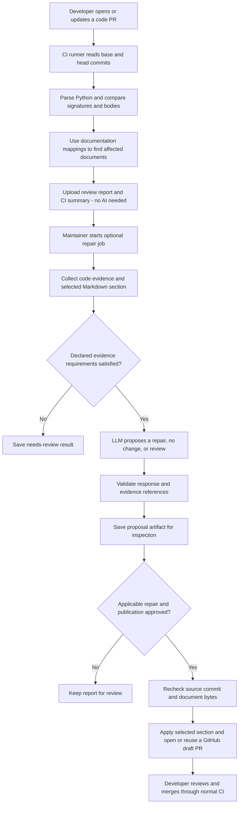
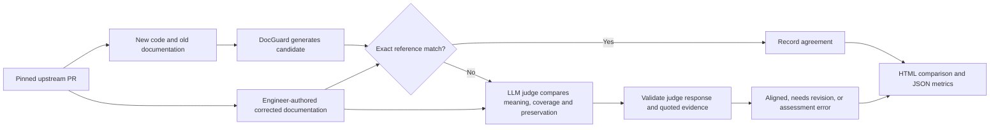

# DocGuard

**Find documentation affected by Python code changes, propose focused repairs,
and review them before publishing.**

For example, a PR changes `total(price)` from returning `price` to returning
`price * 1.2`, but the documentation still says "returns the price unchanged."
DocGuard links the changed function to its documentation, gathers code evidence,
and can ask an LLM to correct the affected Markdown section.

**Status: installable alpha.** Python 3.11+ and Git are required for the full
workflow. Python is the only supported source language; targeted repairs support
Markdown. Groq and OpenAI are supported for live proposals. Offline review needs
no API key. No PyPI or container-registry release is claimed yet.

## How it works

A small `docguard-map.json` connects documentation files or sections to code
entities. DocGuard reads committed Git history and parses source without executing
the target project's code. A changed function identifies documentation to inspect;
it does not by itself prove that the text is wrong.



The publication path is implemented for GitHub. Invalid evidence, ambiguous
sections and stale files are rejected. Text outside a selected section remains
byte-identical. These checks constrain edits; they do not prove every generated
sentence is correct. There is no automatic merge.

## Try it in five minutes

Friends can try this alpha from a source checkout or an audited wheel. Start with
the offline demo: it creates its own Git repository and uses a fixed model
response, so it tests the repair workflow without spending API credits.

```powershell
git clone https://github.com/smaoui-me/docguard.git
cd docguard
python -m venv .venv
.venv\Scripts\python.exe -m pip install .
.venv\Scripts\python.exe examples/verify_installation.py
.venv\Scripts\python.exe examples/section_demo.py --output .docguard-demo-first-try
```

On Linux/macOS use `.venv/bin/python`. Use a new output directory on each demo
run. Inspect `.docguard-demo-first-try/evaluation.json`, the proposal JSON and
`repo/README.md`. The demo checks preview behavior, section preservation and
rejection of reapplying a stale proposal. It does not contact GitHub.

For a real model call, copy `.env.example` to `.env`, configure your own provider
key, and run the section demo with `--live` and a new output directory. See the
[AI setup guide](docs/ai-workflow.md) and [friend trial checklist](docs/first-trial.md).
Never share a populated `.env` with the checkout or wheel.

## Integration into CI/CD

DocGuard adds a documentation check alongside application tests. A **runner** is
the machine executing those jobs. It does not replace your tests or deployment
pipeline, and live benchmark scores are not required deployment gates.

| Stage | Trigger | Output | Current support |
| --- | --- | --- | --- |
| Deterministic documentation review | PR / merge request | Affected docs, reasons, JSON and Markdown | GitHub workflow; GitLab CLI integration example |
| AI repair proposal | Explicit maintainer request | Evidence and proposed section changes | CLI and GitHub composite Action |
| Publish reviewed repair | Approval after inspecting artifact | Draft repair PR | GitHub only; no GitLab MR publisher |
| Model benchmark | Separate bounded evaluation run | Reference comparison, coverage, tokens, errors | CLI; existing GitHub pilot workflow uses the earlier evaluation runner |
| Package verification | PR / manual build | Tested wheel, source distribution and container | GitHub release workflow; registry publication still pending |

The [CI integration guide](docs/ci-integration.md) explains the existing workflows,
runner setup, GitLab example and remaining hosted checks. For a disposable GitHub
application with four test scenarios, use the [CI demo guide](docs/ci-benchmark-demo.md).
Our own [CI workflow](.github/workflows/ci.yml) runs offline tests on Linux and Windows.

## How we evaluate the AI

The repository engineers' documentation correction is the reference. Generation
does not receive that answer separately. Each PR supplies an old-doc repair case
and an updated-doc control, which checks for unnecessary edits.



No manual labels or outside reviewers are required for this workflow. An optional
[manual review UI](docs/manual-benchmark-review.md) remains available for audits
and experiments comparing different methods.

The [November 10 live pilot](docs/reference-evaluation-20261110.md) evaluated four
variants from **two distinct PRs**. Both updated-doc controls matched exactly;
one repair was directionally correct but incomplete, and one assessment failed
quote validation. Coverage was **3/4**, with full reference agreement **2/3 among
completed assessments**. These are pilot agreement measurements, not established
repair accuracy. Generator and judge currently use the same configured model.

Follow [automatic reference evaluation](docs/automatic-reference-evaluation.md)
to prepare cases, run bounded live calls, resume interruptions and inspect outputs.
The [upstream reference guide](docs/upstream-reference-benchmark.md) explains pinned
commits and paired cases. The pilot PRs were used during development; they are not
an unseen test set.

## Development and documentation

```powershell
.venv\Scripts\python.exe -m pip install -e ".[dev]"
.venv\Scripts\python.exe -m pytest -q
.venv\Scripts\python.exe -m ruff check src tests examples
.venv\Scripts\python.exe -m mypy src
```

- [CLI and Python API reference](docs/cli-reference.md): snapshots, mappings, Git review and exit codes.
- [Targeted repairs](docs/targeted-repair.md): section selection, preview, application and draft publication.
- [Distribution](docs/distribution.md): wheel installation, Docker, artifact audits and release steps.
- [Release acceptance](docs/release-acceptance.md): completed checks and remaining gates.
- [Hosted trial evidence](docs/public-hosted-acceptance.md): recorded GitHub runs and publication approval status.
- [Roadmap](docs/project-roadmap.md): current scope and next milestones.

Current limits include maintained code-to-document mappings, incomplete dependency
context, Python-only parsing, model/judge variability and a small benchmark.
Hosted publication acceptance, an external installation trial and registry release
remain separate checks. See the linked records before treating the alpha as a
production service.
